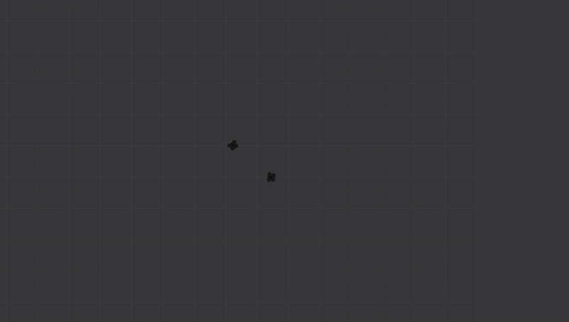

# End-to-End UWB Follow-me Learning

**ROS1 package for Follow-Me behavior using UWB for End-to-End Imitation Learning.**

---

## Installation and Setup

Clone this repository into your ROS workspace and build it:

```bash
cd ~/catkin_ws/src
git clone https://github.com/sahars93/follow_me.git
cd ~/catkin_ws/src
catkin build
source devel/setup.bash
```

---


## Testing Pre-Trained Model in Gazebo Simulation

1. **Install TurtleBot3 Gazebo package:**

We have provided a pretrained model for your convenience and testing using the default Turtlebot3 Gazebo simulation package in ROS Noetic. Install it with:

```bash
sudo apt install ros-noetic-turtlebot3-gazebo
```

2. **Launch the multi-robot simulation world:**

Choose a TurtleBot 3 model (any model works for this demonstration, for example `waffle`) :
```bash
export TURTLEBOT3_MODEL=waffle
```

```bash
roslaunch turtlebot3_gazebo multi_turtlebot3.launch \
second_tb3_x_pos:=0.0 second_tb3_y_pos:=-6.0 \
third_tb3_x_pos:=0.0 third_tb3_y_pos:=-4.0 third_tb3_yaw:=1.57
```

3. **Run the follow_me ROS node:**

```bash
roslaunch follow_me follow_me.launch
```

4. **Control the leader TurtleBot manually:**

To teleop the robot with your keyboard:
```bash
rosrun teleop_twist_keyboard teleop_twist_keyboard.py cmd_vel:=/tb3_2/cmd_vel
```

Alternatively, use the TurtleBot's custom teleoperation interface:
```bash
export TURTLEBOT3_MODEL=waffle && \
roslaunch turtlebot3_teleop turtlebot3_teleop_key.launch cmd_vel:=/tb3_2/cmd_vel
```

This allows you to drive the leader robot, while the follower robot uses the UWB-based model to follow.

<div align="center">
  
</div>
---

## Train your own end-to-end model!

Once you have recorded your demonstration data — including UWB ranges and angles — you can train the model using:

```bash
python3 train/mlp.py
```

The trained model will be saved in ONNX format inside the `models/` directory.

---

## Running the Follow-Me Node for Your Own Robot

To test the model in a ROS environment, launch the node using:

```bash
roslaunch follow_me follow_me.launch
```

> **Note:**  
> - Replace the `Gazebo_uwb_publisher` node with your own UWB data publisher as needed.  
> - Make sure to update the topic names in the subscribers and publishers within the node to match your specific data topics and velocity command topics.

---

## Citation

If you use this code for any academic work, please cite the following publication:

```
@misc{salimpour2025follow,
    title={Follow-Me in Micro-Mobility with End-to-End Imitation Learning}, 
    author={Sahar Salimpour, Iacopo Catalano, Tomi Westerlund, Mohsen Falahi, Jorge Peña Queralta},
    year={2025},
    eprint={},
    archivePrefix={arXiv},
    primaryClass={cs.RO}
}
```
